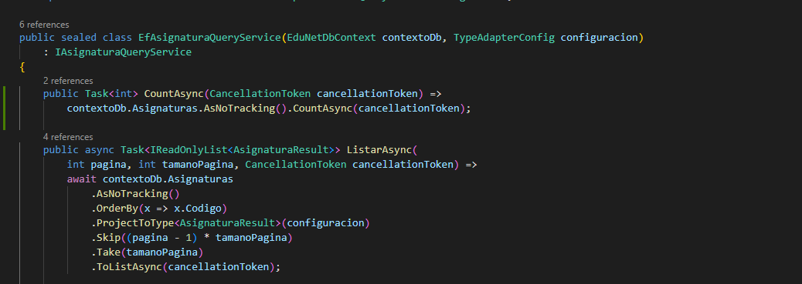
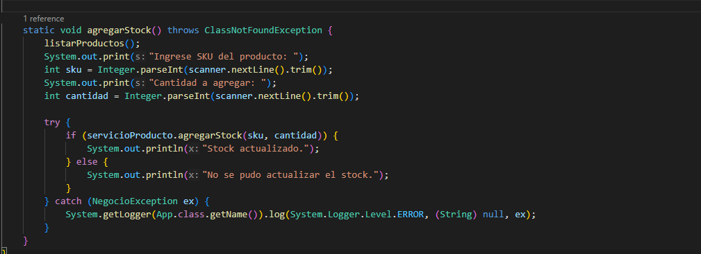
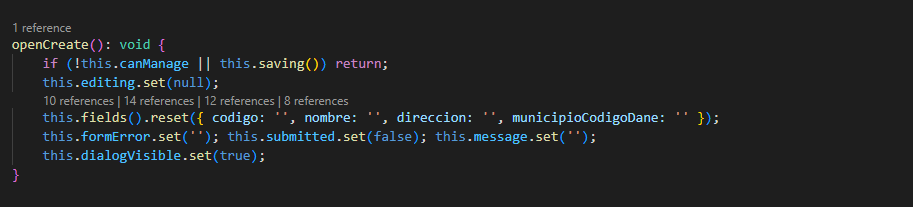
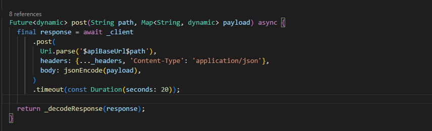
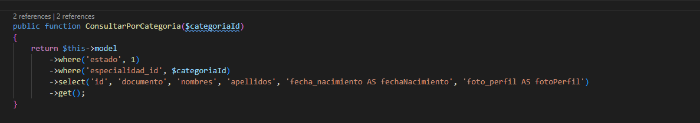

# VS Code References

VS Code References was inspired by the inline reference counts in Visual Studio's CodeLens. It brings a similar way to see and navigate symbol references into VS Code.

See how often a class, method, function, or other supported symbol is used, then open its references directly from the editor.

## Install

Search for **VS Code References** in the Visual Studio Code Marketplace and select **Install**.

## Get started

1. Open the project folder in VS Code.
2. Wait for the language service to finish loading or indexing the project.
3. Open a source file. Reference counts appear above symbols recognized by the language service.
4. Click a count to open VS Code's references view and navigate to each usage.

The count excludes the symbol's declaration by default. HTML element tags do not receive their own counts, while usages in HTML and Angular templates contribute to the referenced code symbol's count.

## Screenshots

Reference counts appear above supported symbols in the editor. Click a count to open the matching references.

### C#



When the active C# extension provides its own reference CodeLens, VS Code References leaves those counts visible and skips its own to avoid duplicates.

### Java



### Angular / TypeScript



### Dart



### PHP / Laravel



## If counts are missing

- Make sure `editor.codeLens` is enabled in VS Code settings.
- Check that the language service recognizes the project and has finished loading it.
- Run **VS Code References: Diagnose Active File** from the Command Palette to see whether symbols and references are available.
- Run **VS Code References: Refresh** to request the counts again.

## Settings

Configure VS Code References in **Settings** or add these options to your `settings.json`:

```json
{
  "vscodeReferences.enabled": true,
  "vscodeReferences.languages": [],
  "vscodeReferences.includeDeclaration": false,
  "vscodeReferences.maxSymbolsPerFile": 150
}
```

- `vscodeReferences.enabled` (`true`): show or hide reference counts.
- `vscodeReferences.languages` (`[]`): limit counts to language IDs, such as `php`, `java`, or `typescript`. An empty list allows every language with a symbol and reference provider.
- `vscodeReferences.includeDeclaration` (`false`): include the symbol's declaration in its count when the language provider returns it.
- `vscodeReferences.maxSymbolsPerFile` (`150`): maximum number of symbols to scan in each file. Increase this value for files with more symbols or lower it to reduce scanning.

## Language support

- **C#:** use a language extension that provides symbols and references. When Microsoft's C# extension has reference CodeLens enabled, VS Code References defers to it automatically. If those native counts are disabled, VS Code References provides its own counts.
- **Java:** install **Language Support for Java by Red Hat** (`redhat.java`) and let its language server finish importing the project.
- **PHP/Laravel:** install **PHP Intelephense** (`bmewburn.vscode-intelephense-client`) and let it index the project.
- **Angular/TypeScript:** use VS Code's built-in **TypeScript and JavaScript Language Features**. **Angular Language Service** adds Angular-specific support.
- **Python and other languages:** install a language extension that provides document symbols and reference lookup.

Reference counts depend on the symbol and reference support provided by the language extension. Declarations preceded by `@override` / `@Override` remain excluded.

